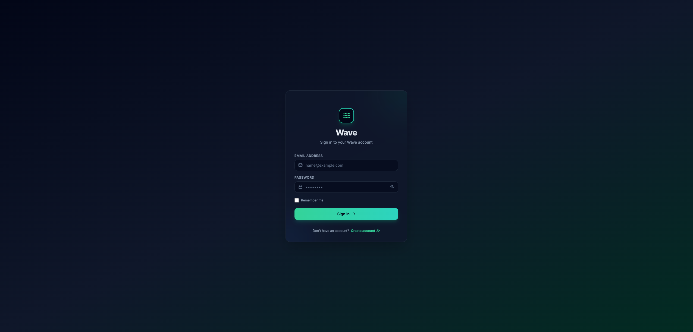

# Wave | High-Throughput Crypto Asset & Execution Engine

Wave is an event-driven, microservices-based digital asset platform built for low-latency market data streaming, atomic balance ledger execution, and real-time AI risk auditing.



The system decouples high-frequency market data ingestion from transactional database paths using asynchronous message queues, pessimistic write-locking strategies, and an isolated LLM processing pipeline.

---

## Key Architecture & Features

### 1. High-Concurrency Transaction Engine (`swap-engine`)
* **Atomic Financial Operations:** Prevents double-spending and race conditions under heavy load using explicit MySQL pessimistic locking (`SELECT ... FOR UPDATE`).
* **Strict Balance Validation:** Financial assertions are calculated after acquiring database locks within `@Transactional` boundaries.
* **Idempotency Safeguards:** All balance-mutating endpoints enforce an `X-Idempotency-Key` (UUIDv4) header mapped through Redis key-value stores to safely intercept network retries.
* **Arbitrary-Precision Arithmetic:** Implements Java `BigDecimal` end-to-end to eliminate floating-point precision loss in ledger calculations.

### 2. Edge Routing & Session Security (`gateway` & `auth-service`)
* **Spring Cloud Gateway:** Central Edge entry point (Port 8080) handling reactive JWT authentication, CORS, and downstream header propagation (`X-User-Id`).
* **In-Memory Token & HttpOnly Cookies:** Access tokens remain strictly in JS memory while refresh token rotation (RTR) is managed via 7-day HttpOnly cookies and Redis token family tracking.

### 3. Distributed Asynchronous Pipeline & AI Auditing (`risk-audit-worker`)
* **Decoupled AI Risk Auditing:** Sub-50ms execution responses are achieved by offloading external LLM analysis (`gemini-2.0-flash`) to background consumers via **RabbitMQ**.
* **Real-time Push Notifications:** Audit reports and execution receipts are pushed down targeted STOMP WebSocket channels upon completion without blocking the primary transactional path.

### 4. Low-Latency Market Data Architecture (`market-streaming`)
* **Frequency Isolation:** Segregates static macro data polling (Redis-cached) from high-frequency ticker updates (WebSocket streaming).
* **Targeted UI Rendering:** Triggers localized UI re-renders on price flashes, maintaining low CPU consumption on the client.

---

## System Architecture

```
                       ┌─────────────────────────┐
                       │   Next.js Web Frontend  │ (Port 3000)
                       └────────────┬────────────┘
                                    │ HTTP / WebSockets
                                    ▼
                       ┌─────────────────────────┐
                       │  Spring Cloud Gateway   │ (Port 8080)
                       └────────────┬────────────┘
                                    │
     ┌───────────────────┬──────────┴────────────┬───────────────────┐
     │ (Public REST)     │ (Public REST)        │ (Internal REST)    │ (Public WebSockets)
     ▼                   ▼                      │                   ▼
┌───────────────┐   ┌───────────────┐           │           ┌───────────────┐
│ Auth-Service  │   │ Swap-Engine   │◄──────────┤           │Market-Stream  │
└───────┬───────┘   └───────┬───────┘           │           └───────┬───────┘
        │                   │                   │                   │
        │ user.registered   │ swap.events       │ PATCH /remark     │
        ▼                   ▼                   │                   ▼
┌─────────────┐     ┌─────────────┐             │            ┌─────────────┐
│  RabbitMQ   │     │ Risk-Audit- │─────────────┘            │    Redis    │
│   Exchange  │────►│   Worker    │                            └─────────────┘
└─────────────┘     └─────────────┘
```

---

## Tech Stack

### Core Runtime & Frameworks
* **Frontend:** React 19, Next.js (App Router), TypeScript, Tailwind CSS, Shadcn UI
* **Backend:** Java 17+, Spring Boot 3.4.1 (Web REST, Data JPA, WebSockets), Spring Cloud Gateway
* **Data Stores:** MySQL 8.0 (Immutable Financial Ledger), Redis 7.0 (Market Cache, Idempotency & RTR Store)
* **Messaging Broker:** RabbitMQ
* **DevOps & Containerization:** Multi-stage Dockerfiles, Docker Compose, Minikube Kubernetes

---

## Microservices Topology

| Service | Port | Database / Storage | Key Responsibility |
| :--- | :--- | :--- | :--- |
| **`gateway`** | `8080` | Redis (CORS / JWT) | Edge Gateway, JWT Filter & Route Proxying |
| **`auth-service`** | `8082` | MySQL (`users`), Redis (RTR) | Registration, Login, Refresh Token Rotation & Profiles |
| **`swap-engine`** | `8084` | MySQL (`wallets`, `transactions`) | Wallet CRUD, Balances, Deposits, Swaps & Ledger |
| **`market-streaming`** | `8081` | Redis | Polling CoinGecko & STOMP WebSocket price feeds |
| **`risk-audit-worker`** | `8083` | None (Decoupled Worker) | Consumes RabbitMQ events -> Gemini LLM AI Risk Analysis |
| **`frontend`** | `3000` | Local In-Memory Auth | Next.js Single-Page Application |

---

## Getting Started

### Prerequisites
* Docker Desktop & Kubernetes (`minikube`) enabled
* Java 17 or higher
* Node.js 20+

---

### Option A: Local Infrastructure with Docker Compose

1. **Clone the repository:**
   ```bash
   git clone https://github.com/bitbyte0110/Wave.git
   cd wave
   ```

2. **Configure Environment Variables:**
   Create a `.env` file in the root directory:
   ```env
   JWT_SECRET=your_jwt_secret_here
   GEMINI_API_KEY=your_gemini_api_key_here
   ```

3. **Start Core Infrastructure (MySQL, Redis, RabbitMQ):**
   ```bash
   docker-compose up -d
   ```

4. **Build & Run Backend Microservices:**
   ```bash
   cd terminal
   mvn clean package -DskipTests
   ```

5. **Start Frontend:**
   ```bash
   npm install
   npm run dev
   ```

---

### Option B: Local Kubernetes Deployment (Minikube)

1. **Start Minikube Cluster:**
   ```bash
   minikube start --driver=docker
   ```

2. **Create Secrets Configuration:**
   Copy `terminal/k8s/secrets.yaml.example` (or create `terminal/k8s/secrets.yaml` locally):
   ```yaml
   apiVersion: v1
   kind: Secret
   metadata:
     name: gemini-secret
     namespace: wave
   type: Opaque
   stringData:
     GEMINI_API_KEY: "YOUR_GEMINI_API_KEY_HERE"
   ```

3. **Deploy Manifests to Kubernetes:**
   ```bash
   kubectl apply -f terminal/k8s/namespace.yaml
   kubectl apply -f terminal/k8s/
   ```

4. **Access Web Application:**
   ```bash
   minikube service frontend -n wave
   ```

---

## Security & Secrets Management
* **Zero Secret Commitment:** `terminal/k8s/secrets.yaml`, `.env`, and local credentials are strictly excluded in `.gitignore`.
* **In-Memory Tokens:** Client Access Tokens never touch `localStorage` or `sessionStorage`.
* **Idempotency Protection:** All financial mutations require `X-Idempotency-Key` headers.
